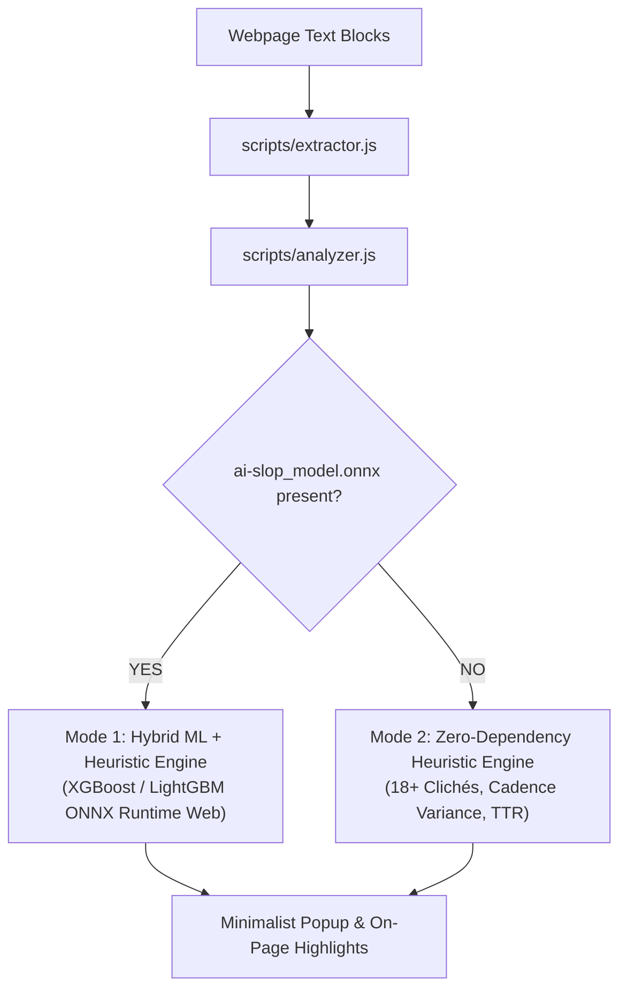

# Is It AI Slop?

A minimalist, privacy-first browser extension to detect AI-generated slop, boilerplate marketing text, and low-quality machine content on any website.

---

## Dual-Engine Architecture (Works With or Without ML Models)

This project is built with a **modular dual-engine design**:



1. **Out-of-the-Box Mode (Zero Dependencies, No Model Needed)**:
   - If you clone this repository and run the extension without any `.onnx` model file, **it works immediately**
   - Uses the built-in linguistic heuristic engine: detects 18+ high-probability AI clichés, sentence length monotony, Type-Token Ratio (vocabulary diversity), and formal transition adverb abuse.
   - Fast (< 2ms), 100% client-side, zero setup.

2. **Bring-Your-Own-Model (BYOM) Mode**:
   - Other developers can train **any model they want** (XGBoost, LightGBM, CatBoost, Scikit-Learn, or fine-tuned Transformers) and plug it in.
   - Place your exported ONNX model at `extension/models/ai-slop_model.onnx`, and the extension will automatically switch to the **Hybrid ML Engine**.

---

## A Quick Start (Running the Extension)

No build tools, Python, or Node.js required to run the extension.

### Chrome / Chromium (Brave, Edge, Arc)

1. Clone or download this repository:
   ```bash
   git clone https://github.com/your-username/is-it-slop.git
   ```
2. Open Google Chrome and navigate to `chrome://extensions/`.
3. Turn on the **Developer mode** toggle in the top-right corner.
4. Click **Load unpacked** and select the [`extension/`](./extension) directory.
5. Pin **Is It AI Slop?** to your toolbar and click **Scan Page** on any article or blog.

### Firefox

> **Note:** Firefox's Manifest V3 support is still experimental. The extension runs in temporary mode (resets on browser restart) until it is published to [addons.mozilla.org](https://addons.mozilla.org).

1. Clone or download this repository:
   ```bash
   git clone https://github.com/your-username/is-it-slop.git
   ```
2. Open Firefox and navigate to `about:debugging`.
3. Click **This Firefox** in the left sidebar.
4. Click **Load Temporary Add-on…**.
5. Navigate into the `extension/` directory and select **`manifest.json`** (Firefox requires the manifest file specifically — not the directory).
6. The extension icon will appear in your toolbar. Click it and hit **Scan Page** on any article.

> **Tip:** If the extension disappears after restarting Firefox, repeat steps 2–5 to reload it. This is a Firefox limitation for unpacked extensions — it does not affect Chrome.

---

## Model Training & BYOM Guide (External Lab)

> **Note on Model Training:** Model training happens **outside this repository**. We strongly recommend using **[Google Colab](https://colab.research.google.com/)** for free cloud CPU/GPU environments with zero local installation overhead.

### 1. Why an 11-Dimensional Numerical Vector?

Instead of running a heavy 500MB Transformer inside Chrome (which causes tab freezing and battery drain), this extension uses **compact decision trees (GBDTs)** running in-browser via ONNX Runtime Web.

Trees cannot read raw text; they require structured numbers. The 11 dimensions capture a mathematical **"stylometric fingerprint"** of *how* text was written rather than what topic it discusses:

1. **Lightning Fast (< 0.2ms)**: Calculated in pure JavaScript with zero external tokenizer dependencies or heavy WASM downloads.
2. **Topic-Agnostic**: Measures rhythm, pacing, and vocabulary diversity rather than keywords—preventing false alarms on technical or unusual subject matter.
3. **Burstiness Detection**: Humans naturally vary sentence length (high standard deviation). LLMs converge toward monotonic, uniform sentence pacing (low standard deviation).
4. **Built-in Explainability**: Enables the UI to display *why* a paragraph was flagged (e.g., *"Low sentence variance"*, *"3 AI clichés detected"*).

---

### 2. Model Input Signature & Data Example

The extension extracts the following 11 numerical features for every paragraph:

| Index | Feature Name | Description |
| :--- | :--- | :--- |
| `0` | `word_count` | Number of words in block |
| `1` | `sent_count` | Number of sentences |
| `2` | `avg_sent_len` | Mean sentence length (words per sentence) |
| `3` | `std_sent_len` | **Cadence variance**: Standard deviation of sentence length (monotony check) |
| `4` | `ttr` | **Type-Token Ratio**: Lexical richness (`unique_words / total_words`) |
| `5` | `root_ttr` | Length-stabilized vocabulary richness (`unique_words / sqrt(word_count)`) |
| `6` | `transition_ratio` | Ratio of sentences starting with formal transition adverbs (*"Furthermore,"*) |
| `7` | `cliche_hits` | Total count of high-probability AI clichés found |
| `8` | `cliche_density` | Clichés per 100 words |
| `9` | `avg_word_len` | Average character length per word (syllabic weight) |
| `10` | `comma_density` | Serial comma frequency per word (complex clause chaining) |

#### Real-World Example: Raw Text to 11D Vector

**Sample Input Text (AI Slop Paragraph):**
> *"In today's fast-paced digital world, navigating the intricate tapestry of modern technology is a testament to human innovation. Furthermore, it is important to remember that seamlessly integrating AI into our daily workflows serves as a vital component and game-changer. Let us delve into how to unlock the power of this paradigm."*

**Extracted 11-Dimensional Feature Vector:**
```json
[
  49.0,   // [0]  word_count: 49 words
  3.0,    // [1]  sent_count: 3 sentences
  16.33,  // [2]  avg_sent_len: ~16.3 words per sentence
  1.25,   // [3]  std_sent_len: 1.25 (Very low variance -> robotic pacing)
  0.88,   // [4]  ttr: 43 unique words / 49 total words
  6.14,   // [5]  root_ttr: 43 / sqrt(49)
  0.33,   // [6]  transition_ratio: 1 out of 3 sentences starts with "Furthermore,"
  8.0,    // [7]  cliche_hits: "fast-paced world", "tapestry", "testament to", "delve into", etc.
  16.33,  // [8]  cliche_density: (8 / 49) * 100
  5.80,   // [9]  avg_word_len: 5.8 characters per word
  0.061   // [10] comma_density: 3 commas / 49 words
]
```

**Contrast with Authentic Human Writing:**
> *"Yesterday I replaced the leaking radiator valve with a brass wrench and fresh Teflon tape. It took two tries because the old threads were stripped, but the heat is finally working again."*
> - `std_sent_len`: **6.4** (natural human pacing variation)
> - `cliche_hits`: **0**
> - `transition_ratio`: **0.0**
> - `label`: **0** (Human)

---

### 3. Training & Exporting in Google Colab (Step-by-Step)

Copy and run these blocks in a new **[Google Colab](https://colab.research.google.com/)** notebook:

#### Step A: Install dependencies & load dataset
```python
!pip install -q datasets pandas numpy scikit-learn xgboost onnxmltools onnxruntime

from datasets import load_dataset
import pandas as pd
import numpy as np
import re

# Load 500 paired human and AI intro articles
raw = load_dataset("aadityaubhat/GPT-wiki-intro", split="train[:500]")

human_df = pd.DataFrame({"text": raw["wiki_intro"], "label": 0})
ai_df = pd.DataFrame({"text": raw["generated_intro"], "label": 1})

df = pd.concat([human_df, ai_df]).sample(frac=1.0, random_state=42).reset_index(drop=True)
print(f"Loaded {len(df)} samples.")
```

#### Step B: Extract the 11 features
```python
CLICHE_PATTERNS = [
    r"\bdelv(?:e|ing|es)\s+into\b", r"\ba\s+testament\s+to\b", r"\b(rich|intricate|complex)\s+tapestry\b",
    r"\bin\s+today['’]?s\s+(fast-paced|rapidly|modern)\s+world\b", r"\bnavigat(?:e|ing)\s+(the\s+)?(landscape|complexities)\b",
    r"\bseamlessly\s+(integrat|blend)\b", r"\bcrucial\s+role\b", r"\bvital\s+component\b",
    r"\bgame[- ]changer\b", r"\bunlock(?:ing)?\s+the\s+power\b", r"\bit['’]?s\s+important\s+to\s+note\b",
    r"\bfoster\s+(a\s+)?sense\b", r"\bembark\s+on\b", r"\bin\s+conclusion\b"
]
TRANSITION_REGEX = re.compile(r"^(furthermore|moreover|additionally|consequently|importantly|notably|ultimately|in essence|in summary)[,\s]", re.IGNORECASE)

def extract_features(text):
    text = str(text).strip()
    words = re.findall(r"[\w]+", text)
    word_count = max(len(words), 1)

    sentences = [s.strip() for s in re.split(r"[.!?]+", text) if len(s.strip()) > 0]
    sent_count = max(len(sentences), 1)
    sent_lengths = [len(re.findall(r"[\w]+", s)) for s in sentences]
    avg_sent_len = float(np.mean(sent_lengths)) if sent_lengths else 0.0
    std_sent_len = float(np.std(sent_lengths)) if len(sent_lengths) > 1 else 0.0

    lower_words = [w.lower() for w in words]
    unique_words = len(set(lower_words))
    ttr = unique_words / word_count
    root_ttr = unique_words / np.sqrt(word_count)

    transition_count = sum(1 for s in sentences if TRANSITION_REGEX.match(s))
    transition_ratio = transition_count / sent_count
    cliche_hits = sum(len(re.findall(pat, text, re.IGNORECASE)) for pat in CLICHE_PATTERNS)
    cliche_density = (cliche_hits / word_count) * 100.0

    avg_word_len = float(np.mean([len(w) for w in words])) if words else 0.0
    comma_density = text.count(',') / word_count

    return [word_count, sent_count, avg_sent_len, std_sent_len, ttr, root_ttr, transition_ratio, cliche_hits, cliche_density, avg_word_len, comma_density]

X = np.array([extract_features(t) for t in df["text"]], dtype=np.float32)
y = df["label"].values.astype(np.int32)
```

#### Step C: Train XGBoost & export to ONNX
```python
from xgboost import XGBClassifier
from onnxmltools import convert_xgboost
from onnxmltools.convert.common.data_types import FloatTensorType
from google.colab import files

# Train model
model = XGBClassifier(n_estimators=100, max_depth=4, learning_rate=0.08, random_state=42)
model.fit(X, y)

# Convert to ONNX format
initial_types = [('float_input', FloatTensorType([None, 11]))]
onnx_model = convert_xgboost(model, initial_types=initial_types, target_opset=12)

# Save and download
output_name = "ai-slop_model.onnx"
with open(output_name, "wb") as f:
    f.write(onnx_model.SerializeToString())

files.download(output_name)
print("Model downloaded successfully!")
```

---

### 4. Activating Your Model in the Extension

1. Move the downloaded `ai-slop_model.onnx` into the extension folder:
   ```
   extension/models/ai-slop_model.onnx
   ```
2. In Chrome, go to `chrome://extensions/` and click **Reload (↻)**.
3. The popup verdict badge will display **`XGBoost (Calibrated ONNX)`** indicating that your custom model is active.

---

## Project Structure

```
is-it-slop/
│
├── extension/                   # Complete Web Extension (Manifest V3)
│   ├── manifest.json            # Extension configuration & permissions
│   ├── popup.html               # Minimalist popup interface
│   ├── popup.css                # Dark slate UI & radial progress meter
│   ├── popup.js                 # Popup controller & state management
│   ├── icons/                   # Extension icons (16px, 48px, 128px)
│   │
│   ├── scripts/
│   │   ├── extractor.js         # Intelligent DOM prose extraction & metadata filtering
│   │   ├── analyzer.js          # Dual-engine: ONNX inference + linguistic heuristics
│   │   └── content.js           # Content coordinator & in-page visual highlighter
│   │
│   ├── models/                  # Custom ONNX models (optional)
│   │   └── ai-slop_model.onnx
│   │
│   └── lib/
│       └── onnxruntime/         # In-browser ONNX Runtime Web library & WASM
│
├── LICENSE
└── README.md
```

---

## Privacy & Security

- **100% Local Inference**: All scanning and analysis happens completely on your machine.
- **Zero Remote API Calls**: No webpage text or data is ever transmitted to an external server.
- **Open Source**: Complete transparency into what is running inside your browser.

---

## Contributing

Contributions are warmly welcomed!
- **Add new clichés & buzzwords**: Submit PRs to [`extension/scripts/analyzer.js`](./extension/scripts/analyzer.js).
- **Improve element extraction**: Help filter edge cases in [`extension/scripts/extractor.js`](./extension/scripts/extractor.js).
- **Share trained models**: Open issues or PRs sharing your ONNX model weights and training benchmarks.

---

## License

This project is licensed under the [MIT License](LICENSE) — free for personal, educational, and commercial open-source use.
