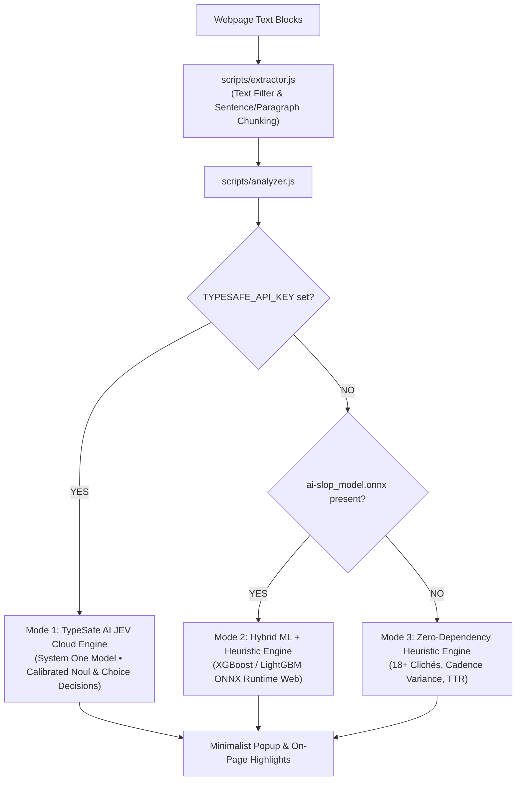

# Is It AI Slop?

A minimalist, high-precision browser extension to detect AI-generated slop, boilerplate marketing text, and low-quality machine content on any website.

---

## Multi-Engine Architecture

This project is built with a **modular multi-engine design**:



1. **Mode 1: TypeSafe AI JEV Engine (Flagship Third-Party Model)**:
   - Evaluates text using **Jev**, the flagship "System One" decision model developed by **TypeSafe AI**.
   - Unlike conventional generative LLMs that output chat token-by-token, Jev executes typed evaluation questions in a single parallel pass, returning calibrated probabilities (`noul`) and categorical choices.
   - Requires setting `TYPESAFE_API_KEY` via `.env`, `extension/env.js`, or the extension popup settings.

2. **Mode 2: Bring-Your-Own-Model (BYOM) In-Browser ML**:
   - Run custom trained models (XGBoost, LightGBM, CatBoost) locally inside the browser via ONNX Runtime Web.
   - Evaluates an 11-dimensional stylometric feature vector in `< 0.2ms` without sending text outside the browser.
   - Active when `models/ai-slop_model.onnx` is present and JEV is not configured.

3. **Mode 3: Zero-Dependency Heuristic Engine (Out-of-the-Box)**:
   - Works immediately with zero configuration and zero external requests.
   - Detects 18+ high-probability AI clichés, sentence length monotony, Type-Token Ratio (vocabulary diversity), and formal transition adverb abuse.

---

## TypeSafe AI JEV Model

### 1. What is TypeSafe AI JEV?

**Jev** is a flagship model from **TypeSafe AI** built specifically for machine-native decision-making and software automation.

- **"System One" Decision Model**: Traditional Large Language Models (LLMs) operate like human "System 2" deliberate reasoning—producing words sequentially and taking seconds per paragraph. Jev operates like "System 1"—a fast, non-autoregressive decision engine optimized for structured, typed decisions.
- **Typed Primitive Questions**: Instead of conversational prompts, Jev accepts a state payload alongside a set of typed questions (`noul`, `score`, or `choice`).
- **Parallel Single-Pass Evaluation**: Jev evaluates all questions simultaneously in parallel, delivering high throughput and low latency.
- **Calibrated Probabilities**: Jev returns exact numerical confidence and probabilities (e.g., `noul: 0.88`), allowing developer code to implement clean threshold logic.

### 2. Request & Response Specification

The extension communicates with TypeSafe AI via the official System One decision endpoint:

- **Endpoint**: `POST https://api.typesafe.ai/v1/systemone`
- **Headers**:
  ```http
  Authorization: Bearer <TYPESAFE_API_KEY>
  Content-Type: application/json
  ```
- **Request Body**:
  ```json
  {
    "model": "jev-latest",
    "state": "In today's fast-paced digital world, navigating the intricate tapestry of modern technology is a testament to human innovation...",
    "questions": {
      "is_slop": {
        "type": "noul",
        "instructions": "Is this text AI-generated slop, repetitive boilerplate, or low-quality synthetic content?"
      },
      "style_choice": {
        "type": "choice",
        "instructions": "Identify the primary writing style of this text:",
        "criteria": {
          "human": "Authentic human prose with natural voice and cadence",
          "formulaic": "Formulaic corporate style or standard academic prose",
          "ai_slop": "Typical AI clichés, repetitive adverbs, or machine-generated filler"
        }
      }
    }
  }
  ```
- **Response Format**:
  ```json
  {
    "model": "jev-latest",
    "answers": {
      "is_slop": {
        "type": "noul",
        "noul": 0.88
      },
      "style_choice": {
        "type": "choice",
        "choice": "ai_slop"
      }
    },
    "usage": {
      "input_tokens": 52,
      "output_tokens": 4
    }
  }
  ```
- **Scoring**: The extension converts `answers.is_slop.noul` (a float between `0.0` and `1.0`) directly into an intuitive `0–100%` AI Slop score.

### 3. Text Filtering & Sentence/Paragraph Chunking

To prevent sending excessively large text blocks in a single call to JEV (which could cause token limits, slow response times, or diluted paragraph scoring), [`extension/scripts/extractor.js`](./extension/scripts/extractor.js) implements intelligent chunking:

1. **Word Threshold (`JEV_MAX_WORDS_PER_CALL`)**:
   - Defaults to **150 words** (configurable via `.env` or `extension/env.js`).
   - If an extracted prose block contains fewer than or equal to 150 words, it is sent in a single call.
2. **Chunking Strategy**:
   - **1st Benchmark — Paragraph Breaks (`\n` / `\n\n`)**: If an element contains multiple paragraphs, it splits along paragraph boundaries.
   - **2nd Benchmark — Period Delimiters (`.`)**: If an individual paragraph exceeds the threshold, the extractor splits it into complete sentences using the period (`.`) delimiter.
   - Sentences are accumulated up to the word threshold; once adding another sentence would exceed the limit, a new chunk (and new API call) is spawned.
3. **DOM Element Mapping**:
   - Each chunk retains a reference to its parent DOM element (`elementId`).
   - If any chunk in a long article section is classified as slop, the parent element on the page is highlighted with the maximum score from its chunks, and clicking a flagged snippet in the popup scrolls directly to that section.

### 4. Browser Security & Background Dispatch

In Chromium and Firefox extensions (Manifest V3), webpage Content Security Policies (CSP) frequently block client-side scripts from making external `fetch()` calls. 

To overcome this, **Is It AI Slop?** dispatches JEV requests through [`extension/scripts/background.js`](./extension/scripts/background.js) (the background service worker). With `"host_permissions": ["https://api.typesafe.ai/*"]`, calls execute in the extension's privileged context, guaranteeing reliability on any website (Wikipedia, Medium, news portals, etc.).

---

## Environment Variable Setup (`TYPESAFE_API_KEY`)

You can provide your TypeSafe AI API key through any of the following three methods:

### Method A: Using `.env` and Sync Script (Recommended for Developers)

1. Copy the example environment template:
   ```bash
   cp .env.example .env
   ```
2. Open `.env` and fill in your credentials:
   ```env
   TYPESAFE_API_KEY=your_actual_typesafe_api_key_here
   JEV_API_URL=https://api.typesafe.ai/v1/systemone
   JEV_MODEL=jev-latest
   JEV_MAX_WORDS_PER_CALL=150
   ```
3. Sync into the extension:
   ```bash
   npm run sync-env
   ```
   *(Or simply run `node scripts/sync-env.js`)*.

### Method B: Directly Editing `extension/env.js`

Open [`extension/env.js`](./extension/env.js) and insert your key:
```javascript
window.ENV = {
  TYPESAFE_API_KEY: 'your_actual_typesafe_api_key_here',
  JEV_API_URL: 'https://api.typesafe.ai/v1/systemone',
  JEV_MODEL: 'jev-latest',
  JEV_MAX_WORDS_PER_CALL: 150
};
```

### Method C: Live via the Extension Popup Settings UI

1. Click the extension icon in your browser toolbar.
2. Click the **gear icon (⚙️)** in the popup header.
3. Paste your TypeSafe AI API Key into the input field and click **Save Settings**.
4. The key is securely saved into `chrome.storage.local` and activated immediately without needing to reload or edit files.

---

## A Quick Start (Running the Extension)

No build tools or servers required.

### Chrome / Chromium (Brave, Edge, Arc)

1. Clone or download this repository:
   ```bash
   git clone https://github.com/your-username/is-it-slop.git
   ```
2. Open Google Chrome and navigate to `chrome://extensions/`.
3. Turn on the **Developer mode** toggle in the top-right corner.
4. Click **Load unpacked** and select the [`extension/`](./extension) directory.
5. Pin **Is It AI Slop?** to your toolbar and click **Scan Page** on any article or blog.

### Firefox

> **Note:** Firefox runs in temporary add-on mode until published to AMO.

1. Open Firefox and navigate to `about:debugging`.
2. Click **This Firefox** in the left sidebar.
3. Click **Load Temporary Add-on…**.
4. Select [`extension/manifest.json`](./extension/manifest.json).
5. Click **Scan Page** on any article.

---

## Model Training & BYOM Guide (External Lab)

> **Note:** If you want to train a custom local model rather than using TypeSafe AI JEV, model training happens outside this repository (e.g. in [Google Colab](https://colab.research.google.com/)).

### 1. Why an 11-Dimensional Numerical Vector?

For users running the local ONNX engine, the extension calculates an 11-dimensional stylometric feature vector in pure JavaScript:

1. **Lightning Fast (< 0.2ms)**: Calculated without external tokenizers or large WASM downloads.
2. **Topic-Agnostic**: Measures rhythm, pacing, and vocabulary diversity rather than keywords.
3. **Burstiness Detection**: Humans naturally vary sentence length (high standard deviation); LLMs converge toward monotonic pacing.
4. **Explainability**: Allows the popup to display reasons (e.g., *"3 AI clichés detected"*, *"Low sentence variance"*).

### 2. Model Input Signature & 11D Features

| Index | Feature Name | Description |
| :--- | :--- | :--- |
| `0` | `word_count` | Number of words in block |
| `1` | `sent_count` | Number of sentences |
| `2` | `avg_sent_len` | Mean sentence length (words per sentence) |
| `3` | `std_sent_len` | **Cadence variance**: Standard deviation of sentence length |
| `4` | `ttr` | **Type-Token Ratio**: Lexical richness (`unique_words / total_words`) |
| `5` | `root_ttr` | Length-stabilized vocabulary richness (`unique_words / sqrt(word_count)`) |
| `6` | `transition_ratio` | Ratio of sentences starting with formal transition adverbs |
| `7` | `cliche_hits` | Total count of high-probability AI clichés found |
| `8` | `cliche_density` | Clichés per 100 words |
| `9` | `avg_word_len` | Average character length per word |
| `10` | `comma_density` | Serial comma frequency per word |

---

## Project Structure

```
is-it-slop/
│
├── extension/                   # Complete Web Extension (Manifest V3)
│   ├── manifest.json            # Extension configuration, permissions & host rules
│   ├── env.js                   # Runtime environment variables (API keys & endpoints)
│   ├── popup.html               # Minimalist popup interface with Settings view
│   ├── popup.css                # Dark slate UI & radial progress meter
│   ├── popup.js                 # Popup controller & state management
│   ├── icons/                   # Extension icons (16px, 48px, 128px)
│   │
│   ├── scripts/
│   │   ├── extractor.js         # Intelligent DOM prose extraction & text chunking filter
│   │   ├── analyzer.js          # Multi-engine: TypeSafe AI JEV, ONNX ML & Heuristics
│   │   ├── background.js        # Background service worker for secure API calls
│   │   └── content.js           # Content coordinator & in-page visual highlighter
│   │
│   ├── models/                  # Custom ONNX models (optional)
│   │   └── ai-slop_model.onnx
│   │
│   └── lib/
│       └── onnxruntime/         # In-browser ONNX Runtime Web library & WASM
│
├── scripts/
│   └── sync-env.js              # Utility to sync .env to extension/env.js
│
├── test/
│   └── test_suite.js            # Unit tests for chunking, JEV parser & heuristics
│
├── .env.example                 # Environment variables template
├── .gitignore                   # Git ignore file protecting .env credentials
├── package.json                 # Project npm scripts (sync-env, test)
├── LICENSE
└── README.md
```

---

## Privacy & Security

- **Local-First Flexibility**: If no API key is provided, 100% of the analysis runs client-side on your local machine with zero network calls.
- **Secure Cloud Evaluation**: When using TypeSafe AI JEV, only the extracted article text chunks are sent to the official TypeSafe AI endpoint (`https://api.typesafe.ai/v1/systemone`). No browser history, cookies, or user identifiers are sent.
- **Open Source**: Full transparency into all code running inside your browser.

---

## License

This project is licensed under the [MIT License](LICENSE) — free for personal, educational, and commercial open-source use.
