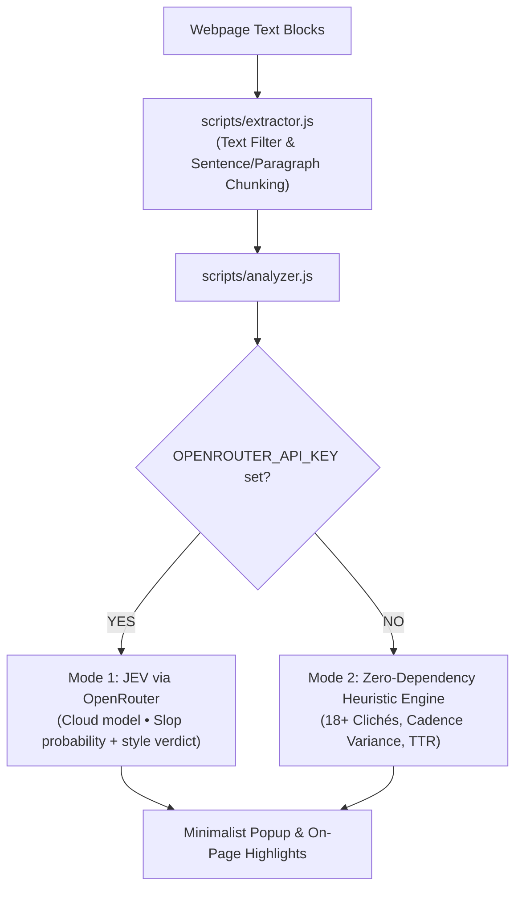

# Is It AI Slop?

A minimalist, high-precision browser extension to detect AI-generated slop, boilerplate marketing text, and low-quality machine content on any website.

---

## Multi-Engine Architecture

This project is built with a **modular multi-engine design**:



1. **Mode 1: JEV via OpenRouter (Cloud Model)**:
   - Evaluates text with the **JEV** model, called through the [OpenRouter](https://openrouter.ai) chat completions API.
   - The model returns a slop probability and a writing-style verdict (`human`, `formulaic`, `ai_slop`).
   - Requires an OpenRouter API key, set in the extension popup settings.

2. **Mode 2: Zero-Dependency Heuristic Engine (Out-of-the-Box)**:
   - Works immediately with zero configuration and zero external requests.
   - Detects 18+ high-probability AI clichés, sentence length monotony, Type-Token Ratio (vocabulary diversity), and formal transition adverb abuse.

---

## JEV Model via OpenRouter

### 1. Request & Response Specification

The extension calls OpenRouter's OpenAI-compatible chat completions endpoint:

- **Endpoint**: `POST https://openrouter.ai/api/v1/chat/completions`
- **Headers**:
  ```http
  Authorization: Bearer <OPENROUTER_API_KEY>
  Content-Type: application/json
  ```
- **Request Body** (the model is set in the popup, falling back to `JEV_MODEL`):
  ```json
  {
    "model": "jev-latest",
    "temperature": 0,
    "max_tokens": 100,
    "messages": [
      { "role": "system", "content": "...reply with ONLY a JSON object: {\"is_slop\": <0-1>, \"style\": \"human\" | \"formulaic\" | \"ai_slop\"}..." },
      { "role": "user", "content": "<text chunk>" }
    ]
  }
  ```
- **Response**: standard chat completion; `choices[0].message.content` holds the JSON verdict, e.g. `{"is_slop": 0.88, "style": "ai_slop"}`.
- **Scoring**: `is_slop` (a float between `0.0` and `1.0`) is converted directly into a `0–100%` AI Slop score.

### 2. Text Filtering & Sentence/Paragraph Chunking

To prevent sending excessively large text blocks in a single call to JEV (which could cause token limits, slow response times, or diluted paragraph scoring), [`extension/scripts/extractor.js`](./extension/scripts/extractor.js) implements intelligent chunking:

1. **Word Threshold (`JEV_MAX_WORDS_PER_CALL`)**:
   - Defaults to **150 words** (configurable via `.env` or `extension/env.js`).
   - If an extracted prose block contains fewer than or equal to 150 words, it is sent in a single call.
2. **Chunking Strategy**:
   - **1st Benchmark — Paragraph Breaks (`\n` / `\n\n`)**: If an element contains multiple paragraphs, it splits along paragraph boundaries.
   - **2nd Benchmark — Period Delimiters (`.`)**: If an individual paragraph exceeds the threshold, the extractor splits it into complete sentences using the period (`.`) delimiter.
   - Sentences are accumulated up to the word threshold; once adding another sentence would exceed the limit, a new chunk (and new API call) is spawned.
3. **DOM Element Mapping**:
   - Each chunk retains a reference to its parent DOM element (`elementId`).
   - If any chunk in a long article section is classified as slop, the parent element on the page is highlighted with the maximum score from its chunks, and clicking a flagged snippet in the popup scrolls directly to that section.

### 3. Browser Security & Background Dispatch (CSP Immunity)

In Chromium and Firefox extensions (Manifest V3), webpage Content Security Policies (CSP) frequently block client-side scripts from making external `fetch()` calls or compiling WebAssembly modules on hardened sites (such as GitHub, Twitter/X, Medium, and banking portals).

To overcome this, **Is It AI Slop?** routes cloud API calls through [`extension/scripts/background.js`](./extension/scripts/background.js) (the background service worker):

1. **Cloud JEV API Dispatch**: With `"host_permissions": ["https://openrouter.ai/*"]`, calls execute in the extension's privileged context, bypassing webpage CORS and CSP `connect-src` restrictions.
---

## Configuration

### API key and model: extension popup

Your OpenRouter API key and model are entered in the extension popup, never in project files:

1. Click the extension icon in your browser toolbar.
2. Click the **gear icon (⚙️)** in the popup header.
3. Paste your OpenRouter API Key.
4. Type your **OpenRouter Model or Preset** (e.g. `vendor/model-name` or `@preset/your-preset`).
5. Click **Save Settings**.

Both are stored in `chrome.storage.local` (your browser profile only). Browser extensions cannot read `.env` at runtime, and `env.js` is bundled with the extension, so the key is deliberately never written to either.

### Default model and endpoint: `.env` + sync script (optional)

The model typed in the popup overrides these defaults. If the field is empty, the extension uses `JEV_MODEL` from `env.js`:

1. Copy the template and set your defaults:
   ```bash
   cp .env.example .env
   ```
   ```env
   JEV_API_URL=https://openrouter.ai/api/v1/chat/completions
   JEV_MODEL=vendor/your-jev-model
   JEV_MAX_WORDS_PER_CALL=150
   ```
2. Sync into the extension, then reload it:
   ```bash
   npm run sync-env
   ```

---

## A Quick Start (Running the Extension)

No build tools or servers required.

### Chrome / Chromium (Brave, Edge, Arc)

1. Clone or download this repository:
   ```bash
   git clone https://github.com/your-username/is-it-slop.git
   ```
2. Open Google Chrome and navigate to `chrome://extensions/`.
3. Turn on the **Developer mode** toggle in the top-right corner.
4. Click **Load unpacked** and select the [`extension/`](./extension) directory.
5. Pin **Is It AI Slop?** to your toolbar and click **Scan Page** on any article or blog.

### Firefox

> **Note:** Firefox runs in temporary add-on mode until published to AMO.

1. Open Firefox and navigate to `about:debugging`.
2. Click **This Firefox** in the left sidebar.
3. Click **Load Temporary Add-on…**.
4. Select [`extension/manifest.json`](./extension/manifest.json).
5. Click **Scan Page** on any article.

---

## Project Structure

```
is-it-slop/
│
├── extension/                   # Complete Web Extension (Manifest V3)
│   ├── manifest.json            # Extension configuration, permissions & host rules
│   ├── env.js                   # Runtime environment variables (API keys & endpoints)
│   ├── popup.html               # Minimalist popup interface with Settings view
│   ├── popup.css                # Dark slate UI & radial progress meter
│   ├── popup.js                 # Popup controller & state management
│   ├── icons/                   # Extension icons (16px, 48px, 128px)
│   │
│   ├── scripts/
│   │   ├── extractor.js         # Intelligent DOM prose extraction & text chunking filter
│   │   ├── analyzer.js          # Multi-engine: JEV (OpenRouter) & Heuristics
│   │   ├── background.js        # Background service worker for secure API calls
│   │   └── content.js           # Content coordinator & in-page visual highlighter
│
├── scripts/
│   └── sync-env.js              # Utility to sync .env to extension/env.js
│
├── test/
│   └── test_suite.js            # Unit tests for chunking, JEV parser & heuristics
│
├── .env.example                 # Environment variables template
├── .gitignore                   # Git ignore file protecting .env credentials
├── package.json                 # Project npm scripts (sync-env, test)
├── LICENSE
└── README.md
```

---

## Privacy & Security

- **Local-First Flexibility**: If no API key is provided, 100% of the analysis runs client-side on your local machine with zero network calls.
- **Secure Cloud Evaluation**: When using JEV, only the extracted article text chunks are sent to OpenRouter (`https://openrouter.ai/api/v1/chat/completions`). No browser history, cookies, or user identifiers are sent.
- **Open Source**: Full transparency into all code running inside your browser.

---

## License

This project is licensed under the [MIT License](LICENSE). Free for personal, educational, and commercial open-source use.
